# 🧊 3D Printer Agentic Studio

[](https://www.python.org/downloads/)
[](https://fastapi.tiangolo.com/)
[](https://trimesh.org/)
[](https://threejs.org/)

An AI-powered parametric 3D CAD studio: describe a part in plain language and an LLM writes Python (`trimesh` + `manifold3d`) code that builds it. The code runs in a sandbox, the result is shown in an interactive WebGL viewer, and you can download a watertight binary `.stl` for 3D printing.

The repository also hosts a library of OpenSCAD models (with thumbnails and one-click OpenSCAD Playground links) and fishing-lure simulation tools.

---

## 🖼️ Generated Models Gallery

Here is a visual gallery of 3D models generated by this project. You can find their source scripts and playground links by clicking on their names below.

| Model Name | Thumbnail |
| :--- | :--- |
| [Battery Holders (AA & AAA)](generated_models/openscad/battery_holders) |  |
| [Box Fan Window Mount Bracket](generated_models/openscad/box_fan_window_mount_bracket) |  |
| [Coffee Filter Mold](generated_models/openscad/coffee_filter_mold) | 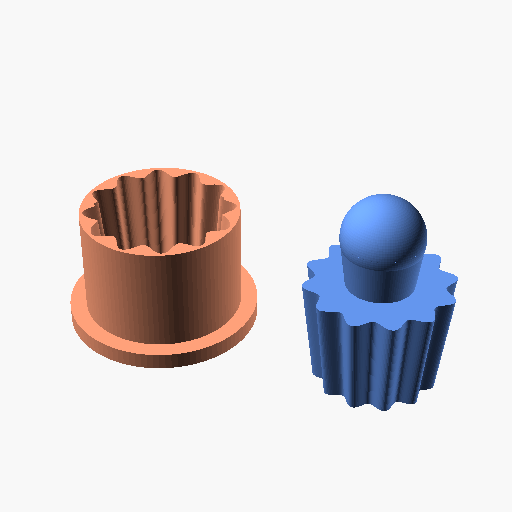 |
| [Door Jamb Hanger](generated_models/openscad/door_hanger) | 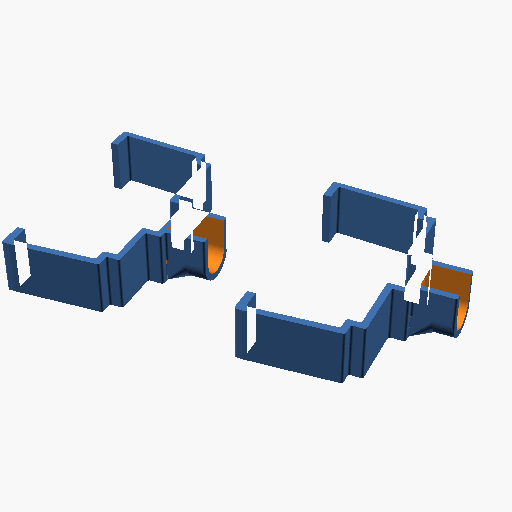 |
| [Fishing Hoochie Wiggler](generated_models/openscad/fishing_hoochie_wiggler) | 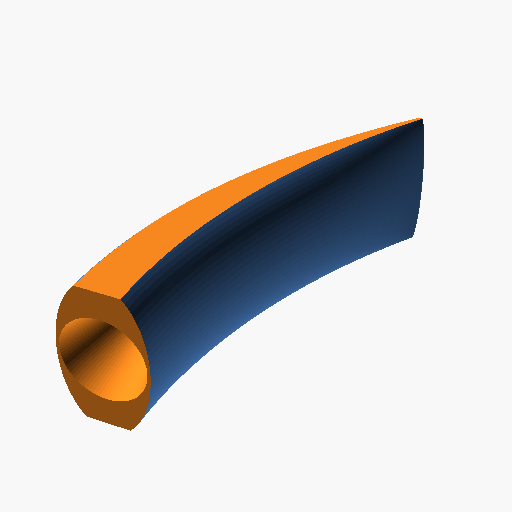 |
| [Fishing Scent Holder](generated_models/openscad/fishing_scent_holder) | 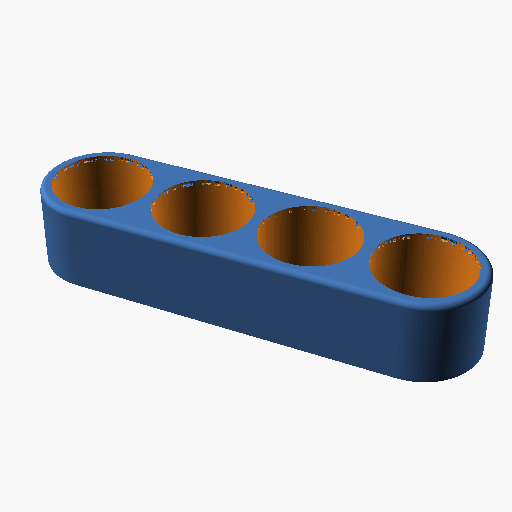 |
| [Diamond Fishing Spoon](generated_models/openscad/fishing_spoon) | 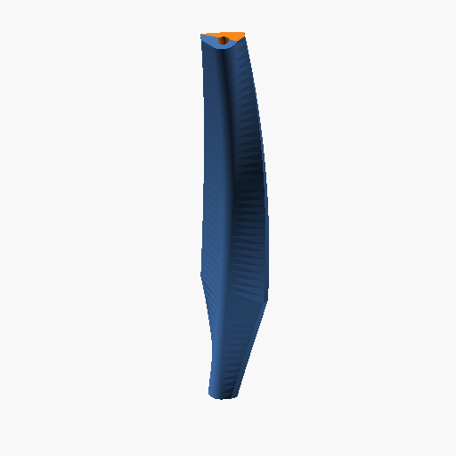 |
| [Gas Can Cap](generated_models/openscad/gas_can_cap) | 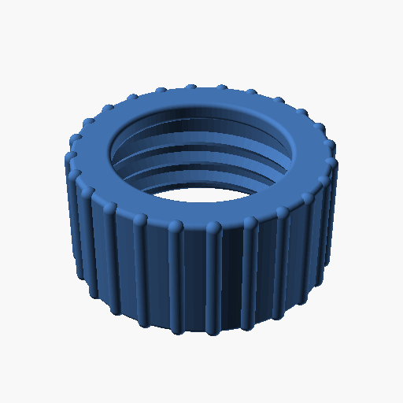 |
| [Hexagonal Table Organizer](generated_models/openscad/hexagonal_table_organizer) | 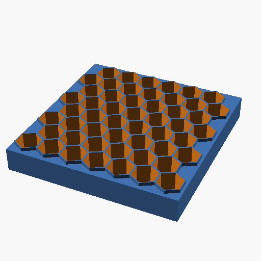 |
| [High Heel Door Wedge](generated_models/openscad/high_heel_door_wedge) | 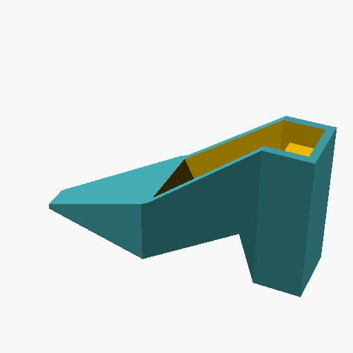 |
| [AI-Optimized King Salmon Cut-Plug Lure](generated_models/openscad/king_salmon_cut_plug) | 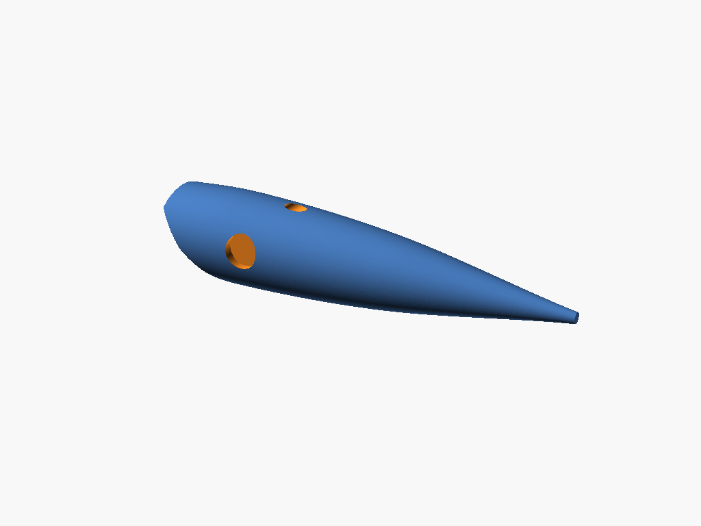 |
| [Circular Leitner Box](generated_models/openscad/leitner_box) | 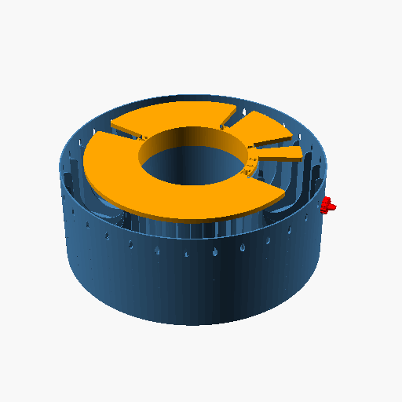 |
| [Lipgloss Organizer](generated_models/openscad/lipgloss_organizer) | 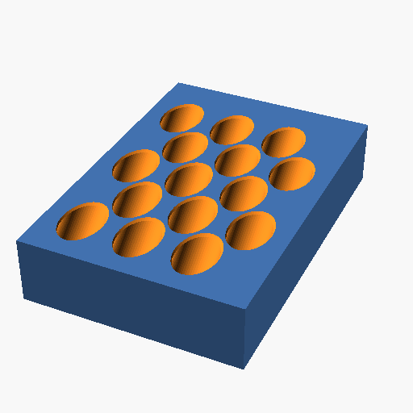 |
| [Square Lipstick Organizer](generated_models/openscad/lipstick_organizer) | 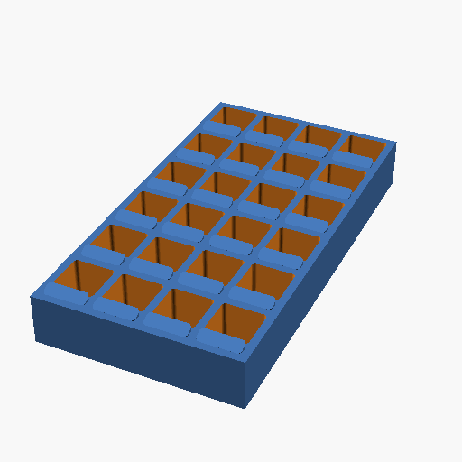 |
| [Rugged Enclosure](generated_models/openscad/rugged_enclosure) | 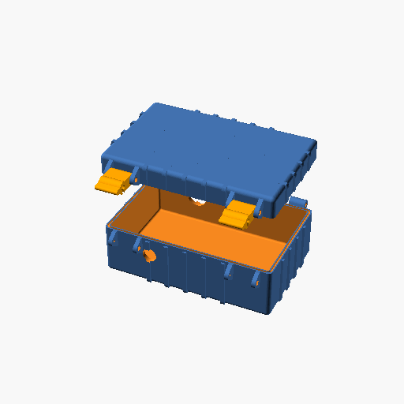 |
| [Salmon Fishing Spoon](generated_models/openscad/salmon_fishing_spoon) | 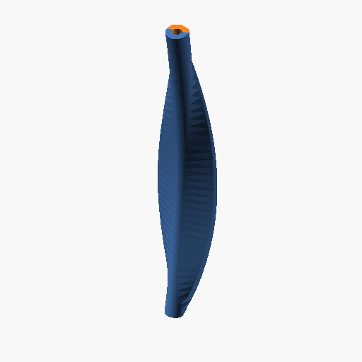 |
| [Siding Light Mount](generated_models/openscad/siding_light_mount) | 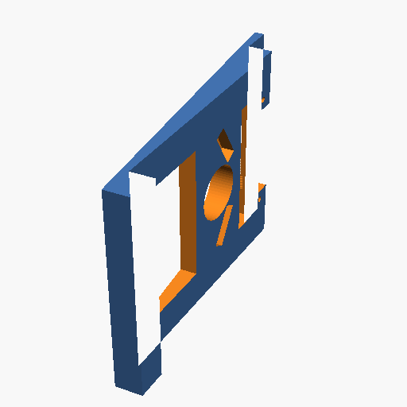 |
| [Toy Screwdriver Handle](generated_models/openscad/toy_screwdriver_handle) | 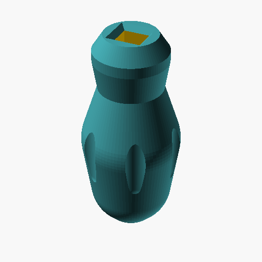 |
| [Window Exhaust Adapter](generated_models/openscad/window_exhaust_adapter) | 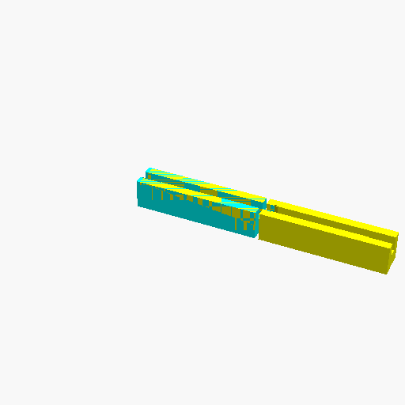 |
| [WOLFBOX G840S Rear Camera Mount](generated_models/openscad/wolfbox_rear_camera_mount) | 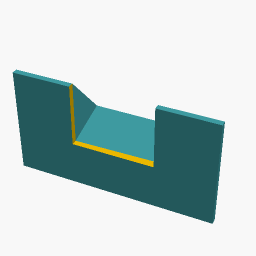 |

---

## 🌊 Lure Hydrodynamics Simulator

Even though this is not directly related to the core AI capabilities of the project, one of the main hobbies that inspired this tool is creating fishing lures. This built-in simulator lets you see how a lure floats, moves, and wiggles in water to test out various designs. 

You can try it out directly in your browser by loading an STL file and playing around with the physics!
[👉 Launch the Lure Simulator Here](https://htmlpreview.github.io/?https://raw.githubusercontent.com/SinaChavoshi/3d_printer_agentic_models/refs/heads/main/tools/simulators/lure_hydrodynamics_simulator/index.html)

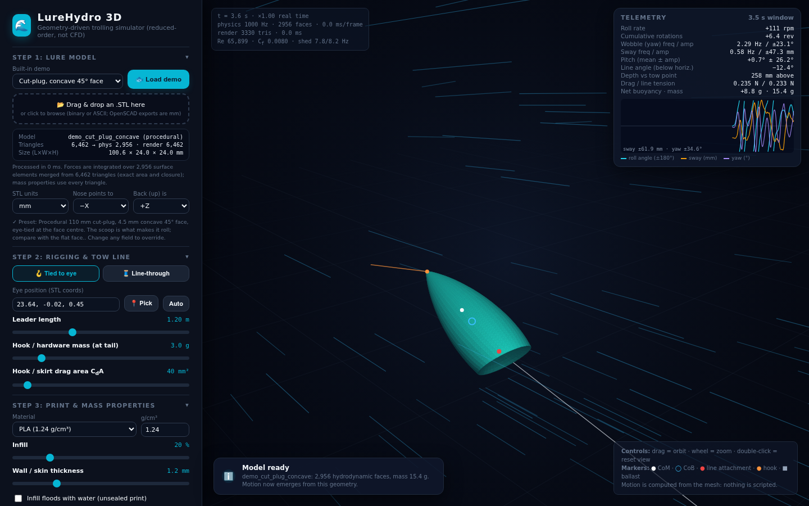

---

## 🌟 Key Features

* **AI-Driven Parametric CAD:** An LLM (Gemini by default; Claude, GPT, Grok, DeepSeek, Kimi, or a self-hosted model) writes Python `trimesh` code for your part.
* **Sandboxed Execution:** Generated code runs in a separate, resource-limited process with a timeout, and can only use `trimesh`, `numpy`, and `math` (no file, network, or OS access).
* **Auto-Correction Loop:** If the code fails, the error, the failing code, and your request are sent back to the model to fix it (up to 2 retries). Failures are reported, never silently replaced.
* **Visual Refinement (Gemini):** The model inspects rendered snapshots of its own result and revises the code if it doesn't match the request.
* **Watertight CSG Booleans:** `manifold3d` engine for reliable unions, differences, and intersections.
* **Interactive 3D Viewer & Print Analyzer:** Three.js viewer with bounding box (mm), volume (mm³), face count, and watertight status; one-click binary `.stl` download.
* **OpenSCAD Model Library:** Hand-designed models with thumbnails and OpenSCAD Playground links (see the gallery above).

---

## 🏗️ Project Architecture

```
3d_printer_agentic_models/
├── app/
│   ├── cad_agent.py      # Multi-provider LLM agent: generation, auto-fix loop, visual refinement
│   ├── mesh_engine.py    # Sandboxed code execution, snapshots, STL/OBJ export
│   └── server.py         # FastAPI: /api/models, /api/generate, /api/generate_stream, /api/export/{id}/stl
├── static/
│   └── index.html        # Studio web UI (Three.js viewer)
├── generated_models/
│   └── openscad/<model>/ # <model>.scad, render.png, README.md (binary STLs are gitignored)
├── tools/
│   ├── decode_scad.py    # Extract .scad from an OpenSCAD Playground link
│   ├── encode_scad.py    # Build a Playground link from a .scad file
│   ├── render_scad/render.sh               # Render a model thumbnail (render.png)
│   ├── simulators/lure_hydrodynamics_simulator/  # Browser lure simulator
│   └── cfd/openfoam_lure/                  # OpenFOAM pipeline for high-fidelity lure CFD
├── tests/                # pytest suite (LLM calls are mocked)
├── Dockerfile
└── pyproject.toml
```

---

## 🚀 Getting Started

### Prerequisites
* Python 3.11 or higher
* [`uv`](https://docs.astral.sh/uv/) package manager (recommended) or `pip`
* Credentials for at least one LLM provider (see Configuration)

### 1. Installation

```bash
git clone https://github.com/SinaChavoshi/3d_printer_agentic_models.git
cd 3d_printer_agentic_models
uv sync
```

### 2. Running the Server Locally

```bash
uv run uvicorn app.server:app --host 127.0.0.1 --port 8088
```

Open **`http://localhost:8088`**. The server only listens on localhost by default; see the note below before exposing it.

### 3. Configuration

Copy `.env.example` to `.env` (or export the variables) and set what you need:

| Variable | Purpose |
| :--- | :--- |
| `GEMINI_API_KEY` *or* ADC + `GOOGLE_CLOUD_PROJECT` / `GOOGLE_CLOUD_LOCATION` | Google Gemini (API key or Vertex AI) |
| `ANTHROPIC_API_KEY`, `OPENAI_API_KEY`, `XAI_API_KEY`, `DEEPSEEK_API_KEY`, `MOONSHOT_API_KEY` | Keys for other providers. Each key is only ever sent to its own provider. |
| `LLM_BASE_URL`, `LLM_API_KEY` | Endpoint (and optional key) for a self-hosted OpenAI-compatible server (default `http://localhost:11434/v1`). |
| `LLM_ALLOWED_BASE_URLS` | Comma-separated endpoints that users may pick in the UI's "Custom Base URL". Anything else is rejected. |
| `STUDIO_ACCESS_TOKEN` | If set, every API call must send it in the `X-Studio-Token` header (enter it in the UI settings). |
| `CORS_ALLOW_ORIGINS` | Extra origins allowed to call the API from a browser (off by default; the UI is same-origin). |
| `CAD_EXEC_TIMEOUT_SECONDS`, `CAD_EXEC_MEMORY_MB` | Sandbox limits for generated code (defaults: 60 s, 4096 MB). |

> [!WARNING]
> Users of the studio can make it call your LLM keys. If you bind to anything other than `127.0.0.1` or deploy the container, set `STUDIO_ACCESS_TOKEN`.

### 4. Docker

```bash
docker build -t cad-studio .
docker run --rm -p 127.0.0.1:8080:8080 --env-file .env cad-studio
```

---

## 🧩 Adding an OpenSCAD Model

```bash
# 1. Extract the active file from your OpenSCAD Playground share link
#    (prints a warning if the customizer overrides any defaults; add --apply-vars to keep them)
python tools/decode_scad.py "<playground-url>" generated_models/openscad/<name>/<name>.scad

# 2. Render the thumbnail (needs openscad + xvfb)
./tools/render_scad/render.sh generated_models/openscad/<name>/<name>.scad

# 3. After editing a .scad, regenerate its README link so it matches the code
python tools/encode_scad.py generated_models/openscad/<name>/<name>.scad --template-url "<old-url>"
```

Then add a `README.md` next to the model and a row to both gallery tables.

---

## 🧪 Running Tests

```bash
uv run pytest
```

The tests mock all LLM calls, so they need no credentials or network access.

---

## 📖 Sample Prompts to Try

1. **Mechanical Gear:**
   `Create a 3D printable mechanical gear with 12 teeth and a square mounting hole.`
2. **Hollow Pen Holder:**
   `Generate a 3D printable hexagonal pen holder container 100mm tall with 4mm thick walls.`
3. **Twisted Vase:**
   `Generate a 3D printable twisted spiral vase with a flared top rim.`

---

## 📄 License

This application is free to use for personal applications, but not for commercial use. You may share and modify it with attribution.

These terms align with standard 3D printing community licenses (e.g., Printables):
*   ✖ **Sharing without ATTRIBUTION** (Attribution is required)
*   ✔ **Remix Culture allowed** (You can modify and edit the code/models)
*   ✖ **Commercial Use** (Free for personal applications only)
*   ✖ **Free Cultural Works**
*   ✖ **Meets Open Definition**
