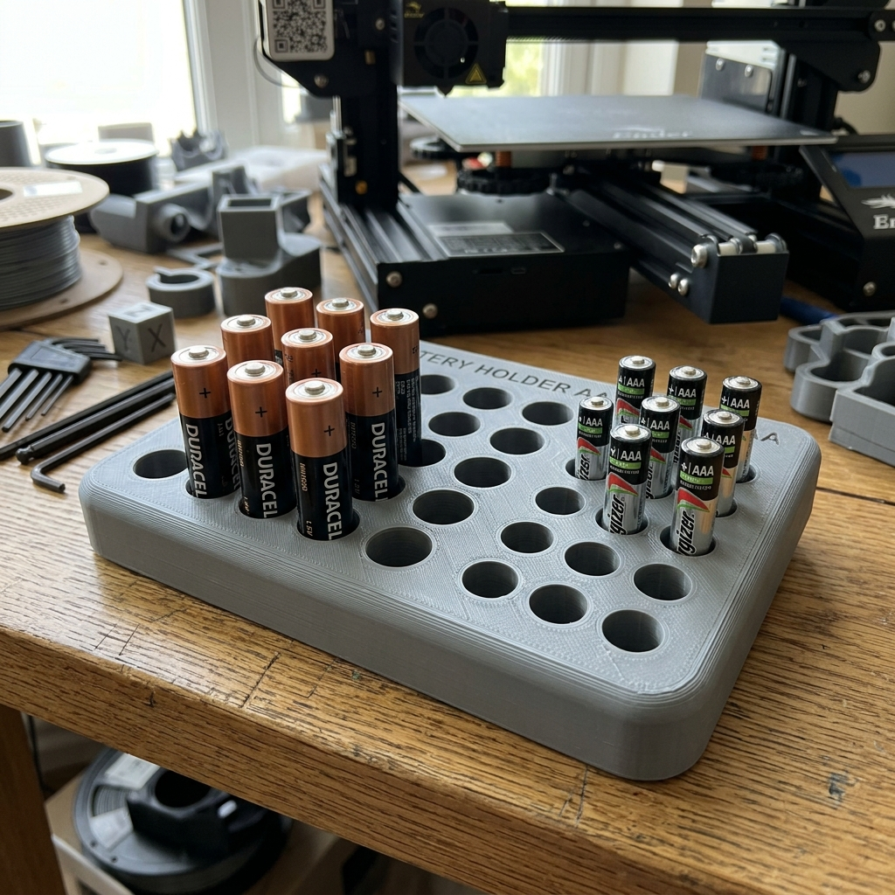

# Parametric Battery Holders (AA & AAA)

## Description
This directory contains two parametric 3D models for simple, grid-style battery organizers. One is designed for AA batteries and the other for AAA batteries. They feature a thick rectangular base with rounded edges and cylindrical pockets to keep batteries stored upright and organized.

### Included Models:
- `aa_battery_holder.scad`: Designed for AA batteries (14.6mm diameter pockets).
- `aaa_battery_holder.scad`: Designed for AAA batteries (10.6mm diameter pockets).

## Try it out
To modify the models or export an STL/3MF file for 3D printing, you can view and edit them live in the OpenSCAD playground by following these links:

- [OpenSCAD Playground (AA Battery Holder)](https://ochafik.com/openscad2/#H4sIAAAAAAAAE61WaW/bOBD9KwNuCzgNHR9JmqwMY5Gk6e4CTQ83RYC1DYGSRhZtiRRIykey/u8LUpbvbrGH/MUavRly3jwO54XkTLFME++FsNDwKX5mJiEeaaQ8UExx1A2Zo9Ahixo4Z1meom7cMs1D3bj7+ms9k1GRoj6zAEJJjMwUCjXx+iRlz4t6IbgUZEjJlCm3iplxbXwmRikS7+KSEm0w9zV/RuK1KXkVC+K1mk1KZjwyiS+kRuK1LC6VxndG4rXPritAgiwiXvucElygH3GWoUFFvGtKFIoIlR8oFk7QEK+1NiVSRsSrFiFe67xJSYS5+9++piRBPkqsy0WTkoBp9LVMeeRX9mtK5BRVynK/crukBEXk49yg0DZpr31JiZEpKiZCJF7zrE3JLEFMd7epczlBP5Eprmg4r2Cr3V1SIoosQOXL2Hdo7YyGqREa3yhkka9zFnIxIt4FJbniwviZjCx1S0q0LFToivJC8v9U31AKg8LYAA2o1+vw+aZ383D/eN/7al8HImDGoFqsMwToQuvi7G0HoNGAmxvQhomIqQhOoXnWyjJYMzQQM5amfsYFrJ8utM6aHXDOD1zwrMgg4jZGiBCgmSEKWK0JViF6IPKUGfRNwsOJQK1dlHbThWk0oA1hBu4jOOBABNIYmW07bK/ahiwDV3wogRCnUqqBCGWqYefpQst5WbePrmAgYwhlWmRCD4SSswOHy0O8hdnoSqDyFYt4oQ+ouJ8bVIKlgNEIQclCRFyMoEQPRJiwLN7x7kLz7HLl/ChzsGqDlOdr38bKZx1jVd+7mw933z7cPP7+6eOqwk6oTvSbNPYpr8M+qSX575ybjMEkuC5bLu3xHIicmzDZ4uZASqdQCaRjhaaxPCAluubq8QZclJMj2BTFyIG7UHOlOI5dZ/7w6d23D/dlzuUpWO8okWmEqnYCLwOn1bKr1E7Kt4jHMSoUIW4Qqyr3LNsYAVb1szuDQtviZVxM5ExPOEgFKRfIlG0mqogQZtzRFmvLUxXPKCa0Jb7W31ELhb3X5vBk47VeZndz9gmLAGv9LWLrltVtHb6B9gmFbTq/AzkUxA5qeNLZXVrnCSqsKejub/5VLKAL581tj+Xm7w69X4vAKBaatbRCNuVmASPFo5JDI3NYKX3jGUsFtRC60G+CB05HdWgND/hxOFXhnIaO4uwTzKG7lhWcQljJDU4Phd2AdudIiMVuCPUvQjzbc7R/FA9xh5YtcQVzCsGCQvB8PNUV+Q+MCwgXKbdn4Tiq+lpLoAtbfeQUWhSiI0e+Kv9lc18w39857HW5/Q533GMr3yaFJt3aXr21fX6+m89e0z1tUVCtY22sAW0Kqm370LFvth/txvp7Fpa7puWPj8mj4lnZgasLjRnQ3F6pmybkaNOrRq0RIjkTM6YifbQB1Tddg0J9q0FQqB/0h206D3rOGzjf7TDOcCRG50fZ2bPuUjMSMsaFsQLFue0P++2pHOv+aWZ7Uf7XtJYDsVxdRj13u7iU7EiXboas6h7qkOWQEpznUpn3UmXMtN8Rj+jpiOyaz635PIud2V0t6k6m0k7m/eGSkinHmR3SUznSxItZqpGSlC1kYay5nChJVqSG22FfhsUGhhE3UhHPqALLSLh+CwttZMafK8vSTpJpynKN0d362yML3EbcRxuK/BT/HF21Q0KJTuTsZm5n2DKivSDLmanawdLOvVhlEKSFSpi2o+6fk97LT6fmej6VC3MlYxmbq3HfXD3dxm9lzBbjPlvEX+LeL9HT7cf3437v9bj/dDvus/lYmetxvzceD+17/CX+/O7V+A9zNR7KOJ5YXxmb6x6P3+qO/V/Gmk/HQ7ZgGE/Y/Olb/OXpVnvmKviNLdiCzV3cfu81m7s1FuO++w3JcvkXzYJxy40NAAA=)
- [OpenSCAD Playground (AAA Battery Holder)](https://ochafik.com/openscad2/#H4sIAAAAAAAAE61WC2/bNhD+KweuA5xGjh9pmk6GMThpOhRo0iZNEQy2IVDSyaJDkQJJxVZS//eBlOV3V+whwIB1+u7I++7j8V5IThXNNPFfCI0Me8Iv1KTEJy3OQkUVQ92SOQod0biFc5rlHHXrgmoW6dbl1z+amYwLjvrEAohHEqSmUKiJPyScPpfNQjApyNgjT1S5VcyMaRNQMeFI/DdnHtEG80CzZyR+1yOvEkH8TrvtkRmLTRoIqZH4HYvj0gTOSPzuybsakCKNid899QiWGMSMZmhQEf+dRxSKGFUQKho9oiF+Z2VKpYyJXy9C/M5p2yMx5u5/951HUmST1Lq8aXskpBoDLTmLg9r+ziPyCRWneVC7nXkERRzg3KDQNmm/e+YRIzkqKiIkfvuk65FZisi3t6lz+YhBKjkuaTitYcvdnXlEFFmIKpBJ4NDaGQ1VEzSBUUjjQOc0YmJC/DceyRUTJshkbKlbeETLQkWuKC8k/0/1jaQwKIwN0IJmswlfBneD66v7q7uv9nUkQmoMqnKVIUAfOu2Ttz2AVgsGgwFoQ0VMVQzH0D7pZBmsKBqJGeU8yJiA1dOHzkm7B877mgmWFRnEzMaIEEI0M0QBy0XBSkSPRM6pwcCkLHoUqLWL0m27MK0WdCHKwH0EBxyJUBojs02HzVW7kGXgqg8VEBIupRqJSHINW49N1XpZtxtXMZAJRJIXmdAjoeRsz+FsH29hNroSqAJFY1boPSqu5gaVoBwwniAoWYiYiQlU6JGIUpolW959aJ+cLZ3vZQ5WbsBZvvJtLX1WMZYFvhx8uvz2aXD/8fPNssROqU716zR2KW/CLqkV+e+dm0zApLgqWy7t+RyJnJko3eBmT0vHUAukZ5WmsTohFbrh6vEaXJSjA1iOYuLAfWi4UhzGrjK//vz+26erKufqGKx2lEoeo2ocwcvIabVqK42j6i1mSYIKRYRrxLLKd5ZtjAHr+tmdQaFt8TImHuVMPzKQCjgTSJXtJqqIEWbM0ZZoy1MdzygqtCW+MdxSiwc7r+3x0dprtcz25uwTFSE2hhvENi2rmzp8Dd0jDzbp/AFkXxBbqPFRb3tpnaeosKGgv7v5V4mAPpy2Nz0W679b9H4tQqNoZFbSiugTMyVMFIsrDo3MYan0tWciFTQi6MOwDT44HTWhM97jx+FUjXMaOoizTziH/kpWcAxRLTc43hd2C7q9AyHK7RDqX4R4tudo9yju4/YtG+IK5x6EpQfh8+FUl+RfUyYgKjmzZ+Ewqv7aSKEPG33kGDoexAeOfF3+s/auYH68c9jpcrsd7rDHRr5tD9rexvaanc3z88N8dprucccD1TnUxlrQ9UB1bR869M32o+1Yf8/CYtu0+PkxuVcsqzpwfaFRA5rZK3XdhBxtetmoNUIsZ2JGVawPNqDmumt40NxoEB409/rDJp17Pec1nG53GGc4EKP3s+zsWXepGQkZZcJYgeLc9ofd9lTNdf80s50o/2tai5FYLC+jO3e7uJTsTMfXU1Z9D/XIYuwRnOdSmQ9SZdR03xOf6KcJ2TafWvNpljizu1rUpeTSjubD8cIjTwxndkrncqKJn1Cu0SOclrIw1lyNlCQruGF22pdRsYZhzIxUxDeqwCoSrt6iQhuZsefasrCjJOc01xhfrr7d09BtxH20ocgvyW/xeTciHtGpnA3mdoitItoLspqZ6h0s7OCLdQYhL1RKtZ11v/O7/KI5D3+9kaXumfPp0JxPx+b8bkrn5pyWtJwOp8Pk9vf44dt1QMuHwXT4cDEd0nL65/xpOr75YP8nt/b38T55q3tyMh3TUia0TB7l8/XLdCiT6VBOaDkdJ7fyOnl8vKRzOqcl/W59zbmcPFzICZ3fTZMvFCs8nVOUyXT8cJHcTodksfgLNCNtjY4NAAA=)

## Key Parameters
- `battery_diameter`: Adjusted for AA (14.6mm) or AAA (10.6mm).
- `cols` & `rows`: Grid size of the battery holder.
- `plate_thickness` (20mm): Overall height of the holder.
- `wall_min` (1mm): Distance between the battery cutouts.

## License
This model is free to use, modify, and edit for personal applications with attribution.

*   ✖ **Sharing without ATTRIBUTION** (Attribution is required)
*   ✔ **Remix Culture allowed** (You can modify and edit the models)
*   ✖ **Commercial Use** (Free for personal applications only)
*   ✖ **Free Cultural Works**
*   ✖ **Meets Open Definition**
