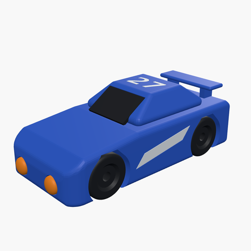
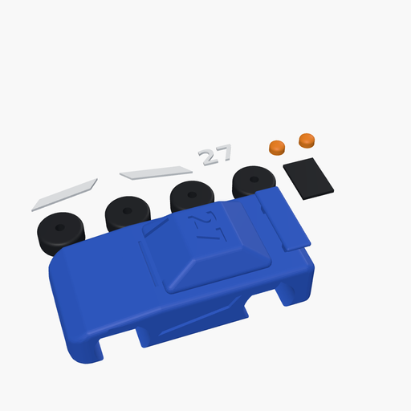

# Four-Colour Race Car Kit

## Description
A push-together toy race car, 100 × 46 × 36 mm, printed in four colours with no paint and no glue for the details. The rounded blue body has pockets for coloured inlay pieces: a slanted speed stripe on each side and the number **27** on the roof, both in white, a tinted black windshield panel, and two domed orange headlamps in the nose. The four black wheels spin on two axle rods that pass through the body.

Designed by chatting with Claude in [OpenSCAD Studio](https://sinachavoshi.github.io/3d_printer_agentic_models/studio/).

### Parts
| Colour | Parts | STL |
| :--- | :--- | :--- |
| Blue | body | `race_car_kit_body.stl` |
| Black | 4 wheels, windshield panel | `race_car_kit_black.stl` |
| White | 2 side stripes, roof number | `race_car_kit_white.stl` |
| Orange | 2 headlamps | `race_car_kit_orange.stl` |

You also need **two 4 mm rods, about 44 mm long** (steel rod, or a 4 mm wooden dowel cut to length) for the axles.

### Printing and assembly
1. Print each STL in its colour. Every part prints flat with no supports; 0.2 mm layers and 15–20 % infill work well.
2. Press the stripes, number, windshield and headlamps into their pockets. The inlays have 0.15 mm clearance per side, so they press in snugly; use a drop of glue if your printer runs loose.
3. Push an axle rod through the body. The body hole has 0.2 mm clearance so the rod turns freely, while the wheel hole has only 0.1 mm, so each wheel grips the rod.
4. Press one wheel onto each end of both rods, hub recess facing out.

Set `print_part` to choose a plate: `0` = all parts (142 × 101 mm), `1` = body, `2` = black, `3` = white, `4` = orange. `show_assembled = true` shows the coloured, assembled car. You can change the roof number with `race_number`.

## Download

- [⬇️ `race_car_kit_body.stl`](race_car_kit_body.stl) (363 KB): blue body
- [⬇️ `race_car_kit_black.stl`](race_car_kit_black.stl) (965 KB): 4 wheels + windshield
- [⬇️ `race_car_kit_white.stl`](race_car_kit_white.stl) (50 KB): side stripes + roof number
- [⬇️ `race_car_kit_orange.stl`](race_car_kit_orange.stl) (109 KB): headlamps

Binary STLs rendered from the `.scad` with OpenSCAD 2025 (Manifold backend). Each one is watertight. On GitHub, click a file for an interactive 3D preview, then use **Download raw file**. To change dimensions, use the playground link below.

## Try it out
To modify the model or print an STL/3MF file, you can view this live in the OpenSCAD playground by following this link:
[OpenSCAD Playground](https://ochafik.com/openscad2/#H4sIAAAAAAAC/9VabW/jxhH+KwMhKCiJtERKdmwL+nB3SZMgRRskbRLEEgSaXInsUaSyS1l+Of/3zuwLuaQo+ZqgH6oDzhI5Ozuvz8wO+dLbhTzcit7tSy+MyvSB/RCWSe+2N8rSex7ylIlRsWO5iMJ4xB7D7S7DK+9DkUZi9OGnb7xtEe/x0gUR9NzemoXlnjPkd9fLwucnb5+nRd5bur2HkNMur25PFHseSZIX3P3P7BYVecnykhiMYE4f+Csy9z4UGf6BH8OIwYeQw/dpqW4vciR8B7u9SLyy2LAyYRzK4gk4kUZIuuMp8owhzWFNPCLJSriQF7DJ9gxyxmK8vy5wYcKQLgufxK1kDPD+b//6Gu6L+Ak+wS/ffvfPr0GkMQNR8nTHBAyBF8Ua8v32Hvf9hOTvPnwPh4SxjG4e0jwWScqyGO/948d3f//ma0hYGGdoCCF3+EWRih2KV+RQHgqYwnYLW1aGGTgo06EoYpZDXBxY1ofwMWO4Z4zyszBKILwv9iVM5ZqsyDcu6sCL/SaRupDgF3KfH8gKaokyAIQC0lJAcchhl4UlQ2HLRFlrhSGE9gX/4mLqAsrAHhh/KpM030BYopyRph4jc2Q/gLufU3ZYwmC0yEVSHFahEGx7n6FZ57AOM8FmaEsUo+Ro8LkWAe/WdDvOHpCHq8iRRkoC6AtUcJFbctFnDuMZqA9yHePvMMuAbqNhfPwpXebco3/7LgR0IQujj4ZighcOSYpK6wtTvFDwMN/oK0at98hGqYWhtMrQD6D398djrVOBxqHd5ZZIsikTRX4AqMinVzPoID+kMVHHLPq4SmrqYGKoE5ZuEjT5GhKMgxFnGNFEjbrR+qgoeCz6i5zurtYc04f4IIdxNweM9lDFeV4ItsgpfO2dJ1OzTga2XtzaLArv03yV5oKVctHlzHhC3gF1B6XZKi0pZQRFDgXcfUj7HsTqcQxd+1o5Q6TwqxayIsf9goaQoqSwILrD6hEspl826VgeA34lA9AmxQGBYkfrUOrVo1+vu76u1lnERhqxK9KMcW01W3t9B3aFKI3pMEEfmHTZImfxhq245eaLSx1DPIzTvSAnYfLmBEfScLSgikUNFX+RGKCCciOpV1HGNcNKFLmcOHGJV1GGioSYt2h5YlNJQYFcWZ7uaFEM3aGiu6l4KzoduorsUcVeI/DUFQlYv9Z00qJk43HDxoaM/q5iK2+qXQ3yQZyGiI6MG55JgUvIBAgKF/5MErPHkoe11gT+FPNKcloAjsj3G1inpYTdRLKmPNrf1x5CjlfV/ngHRcUyJ1omkj5Qpqz9SdcILmvHqr0bHv1Olhr0KIqhHIpfjDcVyl0EmmOtCxUqaQzSQ0AjYyjzOMKlLGIVJ2mYS2WZHeNeMyQkQ7kAdikpaJbHbFcmWjEjhromk44qIO6ua9+uiD4yTO8QbWHYKKEMH2JzNTtKciUyuiCNPuZoXYkNooENlQ80rUr4kOqdzUlk2GrI5TVQ064V9OrlCqP1+nrRwYaOYNpapMNdqW1gxsYtqy+oEUmTP8MxVljkEll+Q/zCnmWl7UnUi17w5aKn/KYvV8FarBc5XluJ9Jkdp7LdlZSYDEBkasGjHd1B14IIOzAus1GF6bemY1ExSl/tFL2uU0QTWimqiHUgNSCviiS5QoUPhtMu22/MsmLLKqQ0AYjdBbYIqoRJAlFi4GCG7WWNqyubZPFkhYFvdJUbFut1VaSUwlmam2XPVg2pBJbLtG266+Ii/2IdKhj+Yi1k2k1n0ooj8PCDOnNsyGP5w8DH8z3IbkShsgc1ps/qgDT4p/dFOLN2RtTkUbLSNcBwGoJvMbA5KSSiNRWSSQZUDaWhLi67Vlqi0NI1No0eLWkUOpJSZhP2UkqesAzzwNF9hgeO7nU88LEzM5XdA9kQ9GeEPSZ/56BT2YNgoJFRExy0d2TaNm/rlKN1Mj2rKxrKJsYj8/YHNckQHsXxnUWuzimYqVnm8D68mIKPxw3dC8vWdichWRTY6WDKIRzimScqsyfK22eqShg+aG4Snhcldt0rqlT7mDlfrPO5f9VfVMCFrJ42Re7cETw74fzOuxnf+pe3N+NlH+74ICqEE5IJByLN8dtySdZ7Palc8BWIJKRDy2n1Mjxk8NWOF2vsYxxUU4lTiXIXuOOle6d7Ya/xy51Y35WTPbxUKyQ/1dqppsFFk6v6+7Vrd7LHy33Xv0Sysev78s+kUluroHrTMyrIQDMC+lJm6v7sK9RHuipi6ZeKUXOhtR9mwEratd4r2WOQ9GVZdQT6DWVeVjfpg71JLujM5aC+IAaOPC2MAu+6j4RRyrE2O9e0T8eK2oD2yqm1cmpWvtqCUtIGsVPFLoYdNr50Mi6xEYh5sbtVZ67wXlPrKkOc6AjNBYtKPPs7DV20si9NR2lJFC7ZijR94SmCkfidl06Awdz8feT+Kgzgjy4cG9KBIV3a4r12mlyLiY4E89VgN8ZLv7mX+H0fclwUDBTpMDBbDs2ioT80gLvs9JVCLNtbKImcYogdo/9V31AmeKbiqcCcLosDOlH1BujOdtCP3QAjObhxv8Q/NUK6Bhrx6qV73Y5t1Q8oMWzQchCK+rKvcKyWxZVNxtw0JXiSxxyeL3pfsX+HP+/hJzTnrSifMjZ/X2TxonfCR0mYpZsc11GpxRai58JD+9J5pHsvz/40uem/iXVURmsrMzwEoHmjAkF9aNBdzRZk425OZ0rybZp/LA7iY9qM/9O5Ylnw7mbs4j9MWivO6JJXpbQ6Lfbb8UUfalWQytQOucILBnqF7m2w0mZlODd82uDeSsq2GARZrW0UQg6DagNeM7dgsDudZOXU1F0hL3G7Ntf/mW1bVadl226MPLI61PJZExazhwumQg3VlS7hJfbu7+sy4YJRwGZp1HGxQx37y7a8nyvZtJZNFUf921Nc/7B4128J+PqHQkyPZ2pPNCt0J/RjKGGZ9X0Pm+LKA+OLS6q2UpErFyYuVDOhId6r5TWTAMQUPKduaBK53aqj7nGr8Di/u76hXW6uly48kVjI3L86Idkj0hiJhvX+lLfSEH4Ty/VZfM3xZFZbwOKn+iIY13GGnExGYe6onl6mVZSkWcxZ7rS2wCPtSlcUdZ7r3MgcobXvR8EQ66o5KFt7miyutW+lpjWlGPp9q2g2pDIIr9jE6XqNoJ5HrJmQ8qmGLAR2XZgZWJrVwTOzQ65xmmKivmE82hiPuWBPwdDJ2zl1sqjzNuW84GTnbVPlY6dbRjP9xFmjnTCeHu8NJ/2qM5w19DLPEdSUyTwdqZ4//HeqntXIM9jSrZJ3WqfoCbXCQ7UTz9XgcKjPgS4kc8kVq1VTLXvuomdWLsYIHuDklLqm7Ypmi1XtMV/mxBvknTMvRWdt2czRZnIKgmE6746wofTs0VrbMgqY1NnZlUdkF2z6YbBsiWZPf9pCWVLI8ZGECA33VgYetwut9Kybyebe1dDITBD1rFZNcRpB1gHV7U6doGSgRj8uqFlOA8Zu3o4kNXsaBoNqiErRVA+yhn6zupzoQvW43pGPBM81ojLk6x602GOLA2t6fInd/fOcTixm2lslpZpd/uZW5UXPlc9BXGvg0DJC1dJZQ+12t2PfOjahOfhoKpPLh+WJg2zVZh5ncXOwT+Y3cBWcY6Z6hZof9+dyno9mCtQ3LOMBscM/n+fEOmffdqTOMZXc0qEqE/VEywU5uWrm4pLqiQZc9Zx6k4VCwC7MWXZSLDORBUc9VD4nlcmvOsIwpiAV6gExPRTVY1OavLpqpoq1LsdM3OMGw2ft6qMM8U5nCDnC2LflpJrKTsPzfb2IQuyqafbjVoPhkeMci9EfBZ09vTrJnZCcJm/T8ZnzkKdWIeqaL+Oq/QsG5lr9rZJx6LeHC6cjTT8LcuRLBmejTNcYesaiGpaTsNvO39pOdrME7QP/n+VtIT2cVvidevT/BCP9kP+MztVrAp0NJYVVPTVvjtroTQPuLHq8eAozeh1g0evrlnB2TCXfCSCKl5PBcNS9nu1dW95qxVi7h/gfbfP5Fbzp/+6DvLGVfKGCbPVG11K3ZLp7sS40kbANoB0OUu9o0K6f2RDUcPNGY+CpzsCCy7o+dKr9WW3viakvugCOml7e5VjTHcxO8fGOzgO8q3du8TFQpPNLvV2j0rBOMXqTh97f2ecKl3f9xutBcxjDp0+tSzu9QbpG7+B6PIb2PyMJZQ96gODWvDtFj5GthtmRZu+bIeSB3ujRitODrjG9a6WUb+8fWPtXvntpNZYpnsNuJ80MrJ+jpQMnGOifQ38spx2HQFWBs+6Zdi4ETzUCI82iO+pfG4aZ3FavnJFldKvuSLxCttU7ZfTGGGVIbSl61UnuOrSfDI7bZppYZupCweY4iPhq4U8BzzGW0RM57StrAm3xMnDovwVqFu9g0OAeEHczgSYDSwvUl9RGOjtoiN2JeK8t40wt47QQSEbOqeFRS7gJCRcMqqf2Q90pyBjGINMHj+t+Jba5r8RuQJNMXyNh/b5d366VM2D0Ll0zu3Ft73Xp9tjjruDlXwu+Dcvgq95tTzxses3LE3m5zHqvbo9ezqN3ShUb+obYwfD+dp+VKS2M07LgvVt6DqrIWfUr2ouy2KLO+srr6+t/AHJ08iaoKgAA)

## License
This model is free to use, modify, and edit for personal applications with attribution.

*   ✖ **Sharing without ATTRIBUTION** (Attribution is required)
*   ✔ **Remix Culture allowed** (You can modify and edit the models)
*   ✖ **Commercial Use** (Free for personal applications only)
*   ✖ **Free Cultural Works**
*   ✖ **Meets Open Definition**
