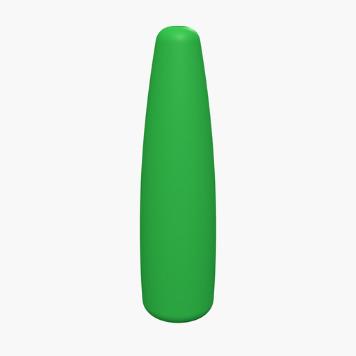
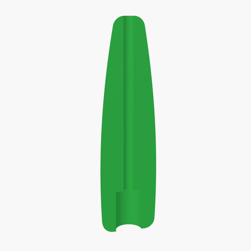

# Squid Jig Body

## Description
A spindle-shaped body for a DIY squid jig, 40 mm long and Ø10.6 mm at the belly. The line or leader wire runs through a Ø2 mm centre bore and comes out at the rounded nose. The fat end (tail) has a Ø5 mm, 8 mm deep socket for the hub of a squid-jig crown (the ring of barbless needles).

The body curve is a single circular arc revolved around the axis: widest 10 mm from the tail, narrowing to about Ø10 at the tail and Ø5 at the nose, with both ends rounded at a 2 mm radius. The OpenSCAD code was reverse-engineered from an existing squid jig 3MF and matches its surface to within 0.04 mm.

### Printing
Print standing on the tail with no supports. The original was printed in PLA at 0.2 mm layers and 100 % infill, so the body is solid and sinks; glow-in-the-dark filament is a popular choice for squid. Set `copies` to lay out a whole plate (the original plate had 12).

## Download

- [⬇️ `squid_jig.stl`](squid_jig.stl) (1747 KB): one squid jig body

Binary STL rendered from the `.scad` with OpenSCAD 2025 (Manifold backend); watertight. On GitHub, click a file for an interactive 3D preview, then use **Download raw file**. To change dimensions, use the playground link below.

## Try it out
To modify the model or print an STL/3MF file, you can view this live in the OpenSCAD playground by following this link:
[OpenSCAD Playground](https://ochafik.com/openscad2/#H4sIAAAAAAAC/6VX32/bNhD+Vw7CCkiJHP9oOxQO8tCu6IChD0XbtzgIaImyuMmkRlJx7CD/+74jJdlOCwzD9BBY5PG7+47f3SlPSSus2Lpk+ZSIwqsH+UX4Olkm00atrbBKuqlppXaFKKfyUWzbBisfhFOFm/727ffJ1pQdlq7YIMmTSgrfWQm826QRh/2k08ro5C5PHoRlL8954kxni2DyBO//x1thtJfaM8CUbvihb393qqQ/1IY+mHIfF1ca2+/JtUqXjZy4WrSyJBcs/4Tlmi19LTy5RpXSkdEkqFFakrG0U1Ze0fdaUgULqUtKvVBNRrVwJAK2M8Vf0lMFaw+7uluTqQARXEzYRWHNTuMgdq3SG95eC7sGF0daSoTlsutwOLi1nXYB2dfWdJsaWAWIWolY8UcgCPmoPPz7cAhGugQnbZy8Cge/ygdpnZxIvQGgtNisrNnGkO4R0v3D/Or1tlrSmxltt9QYvclp1c1m5bv57OpXXuvB17Jp9hH1C4KHV+cRQaChiaPgfORwTq5rW2OxEpgaq+BcNLRDplo+iiiUpi+f3zP2fDajV3ivVNNkwIeHC7rla7uji+lKN4jd1xSfG8R5zT8QhQE10TQUDfLgnrwJ7Fc6hHtfDseYzHU41gi7kc5TqcRWemkH09a4wXTwUCqmWEi+J2ayY1l4ag04xDzyKvtdafY6uAPI24ARQaIf2tXIfzjBtrQzXVMGIa1lxdcZbg/pXGks3oe3iLUYsQYTsqJUnRviCsxZDQFYluA35PEz62hUS9Rf1GnMLm+dhH101QutNo0cFR1EiQxKUcpYESsdwXqIU959NeCixxAHnBgG6uN4XLa44xt6d0xbWAkEuSKD2UAq6A8XuTddT6MwLbrGSGM+wtRmR1uh91zdbAF94Bzh4Atxto3woCtKmi8yxNWKghM95OXt9XleRmmspd9JqQd8E+kGNA73l0rErPxSOfyYXQEp0JjSBE9sOkVnH+QSZ5EaZYsOEiVhiyF36SEnmzGmljlVgKY0SjHjAjrKlxEDNLcpBmiFc0y6bx/paJr3pwC7U54bS41MHNBIkQoQ24BlUEx/NKCmQ6UFrdu+U4WbHUVemaYxOzdUB4e66haLN+/GpjKqoJSV6BrvuOj7aJChoW6n0GJfVZZvoK+vuAxu91/DxaSt2fVx0YRO+C0yuiTeHKAnfdi8lQEnXdAF/bCbZYCvOo0haMKlYjM9ZGNgbBm9X6KJWp/Gl4t+cRJcHl6GwqCcp0ilR51lQQnOy5alMV/MBmV86tDWnGpq00kPVaZrA3ouDqVY8uJRuQxlEV64iYSqp0Ig6OMggIAWH5HeODBPINOMnlaaJQ391x7ub/laUsW/ZssQ012GSvcgc9O3WLBUSFzYzOh2TE5Oh7u76wjXyMrTOVywX07my9m/IU5+CtmaZr8xOsWYL4RPQ8B5cBTy+sxJ6wmG8601mCWBYt81A8VaNNWQvSE/x4TkQZbWeNTtvXz0titldM/zCiM0COKYNn5MVTnQYdWOHTsbVkvZeC79ycnWaf6vjzjeCu24YaS3s5wmc6QJ81lYvA+iu6R5PuTskhZ3w/Hnc/7Hsc6ZOEZbqqrC8EG/Omdwzhd75wk8iZEH5zBKclyYFSGpY3v4OZeBTrHHYcyMtAzy55GTU32UASjl6JAaK69nL9yezqzTafKffA5jJno9GzpI7ctswutnsY9fPX1bx7wIn4Mbq8r87MsHVsqGiNwVD6KGi7mQqklDf4iTKbaVY4XRkvqRNSEEG92f8IDZK2KsDCXSzyJu/cbYlCvmh61ZFM3Z7Yd2IovapLivdJV8P+3US1olaE3AiI0JX30JvvbyMDfi50U0CY2t310lgUjyjC95+cjfeJ+M3Qq/+IiPb/ewSc6XX4dl3yT43H9Qcsf/XsSpzb+gWYn9LWaA4oOl8sYmS0hRRnM5vhWd82arDsPK8/PzPyooK+azDAAA)

## Key Parameters
- `length` (40 mm): overall length, tail to nose.
- `belly_d` (10.6 mm) and `belly_pos` (10 mm): largest diameter and its distance from the tail.
- `nose_d` (5 mm): nose diameter before rounding; the tail diameter follows from the curve.
- `end_round` (2 mm): rounding radius of both ends.
- `bore_d` (2 mm): centre hole for the line or leader wire.
- `socket_d` (5 mm) and `socket_depth` (8 mm): tail socket for the crown hub.
- `copies` (1) and `spacing` (25 mm): lay out several bodies on one plate.

## License
This model is free to use, modify, and edit for personal applications with attribution.

*   ✖ **Sharing without ATTRIBUTION** (Attribution is required)
*   ✔ **Remix Culture allowed** (You can modify and edit the models)
*   ✖ **Commercial Use** (Free for personal applications only)
*   ✖ **Free Cultural Works**
*   ✖ **Meets Open Definition**
