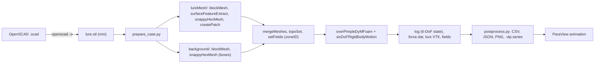

# OpenFOAM 6-DoF towed-lure simulation (overset, URANS)

High-fidelity CFD pipeline for 3D-printed trolling lures: the lure STL from
`generated_models/openscad/<name>/` is towed through water on a leader and is
**completely free in all six degrees of freedom**, so roll/spin, wobble, sway
and the leader angle *emerge* from the lure's shape, mass distribution and the
flow (vortex shedding, separation) instead of being prescribed.

> [!IMPORTANT]
> **OpenFOAM has not been run on this pipeline.** OpenFOAM is not installed on
> the machine where it was written. Every dictionary was written against the
> real **OpenFOAM v2412 (ESI/OpenCFD)** tutorials and source code (see
> [Provenance](#provenance-what-the-dictionaries-are-based-on)), and the Python
> tools, the generated dictionaries and the shell scripts were validated
> locally (see [Validation performed](#validation-performed-without-openfoam)),
> but the first real run may still need small fixes - see
> [Open risks](#open-risks--things-to-check-on-the-first-run).

| | |
|---|---|
| Solver | `overPimpleDyMFoam` (incompressible, PIMPLE, overset, moving mesh) |
| Mesh | background `blockMesh` box refined with `snappyHexMesh` boxes + body-fitted component mesh around the lure (`snappyHexMesh` from the STL) merged with `mergeMeshes`; zones via `topoSet` + `setFields` (`zoneID`) |
| Body motion | `dynamicOversetFvMesh` + `sixDoFRigidBodyMotion` (Newmark), no constraints |
| Leader | `linearSpring` restraint: anchor = boat-side end of the leader, `refAttachmentPt` = tow eye, `restLength` = leader length |
| Weight / buoyancy | gravity given to the motion solver (`g` in the coefficients); buoyancy rho V g applied at the centre of buoyancy by a very long, soft vertical spring |
| Turbulence | URANS k-omega SST (default), optional k-omega SST DDES, laminar |
| Inflow | uniform tow speed with a smooth start-up ramp and optional bounded ("limited") fluctuations (time table) |
| Regime | 1.5-3.5 mph (0.67-1.56 m/s), 50-130 mm lures, Re ~ 1e5, fully submerged |

---

## Contents of this folder

```
tools/cfd/openfoam_lure/
  README.md               this file
  prepare_case.py         STL -> ready-to-run OpenFOAM case (mass properties, leader, mesh, inflow)
  postprocess.py          6-DoF/forces analysis: roll rpm, wobble frequency, sway, line angle, drag
  template/               case template with @@TOKENS@@ (filled by prepare_case.py)
    Allrun, Allclean      meshing + run scripts (OpenFOAM RunFunctions), serial or -np N
    lureMesh/             component mesh sub-case (blockMesh, surfaceFeatureExtract,
                          snappyHexMesh, createPatch -> overset patch)
    background/           background mesh + solver sub-case (system/, constant/, 0.orig/)
  tests/
    check_case.py         static checks of a case/template (balanced braces, tokens, files)
    make_synthetic_run.py fabricates an OpenFOAM-like run (log, force.dat, ...) for testing
    test_postprocess_synthetic.py   regression test of postprocess.py on synthetic data
  examples/king_salmon_cut_plug/   generated example case (dictionaries, case_info.json,
                          README_CASE.md and a 0.9 MB binary STL; *.stl is gitignored
                          in this repo - regenerate it with step 1 + prepare_case.py)
```

The two-sub-case layout (`lureMesh/` + `background/`) is the same as the ESI
overset tutorials (`floatingBody/{floatingBody,background}`,
`cylinder/{cylinderMesh,cylinderAndBackground}`).

---

## Requirements

### OpenFOAM v2412 (ESI / OpenCFD, www.openfoam.com)

Any of the following (run these yourself; nothing was installed or executed by
the tooling). The ESI repositories moved from `develop.openfoam.com` to
**https://gitlab.com/openfoam/core/openfoam**; packages are still served from
`dl.openfoam.com`. Check https://www.openfoam.com/download for the current
instructions.

**Ubuntu / Debian packages (also works in WSL2 on Windows):**

```bash
# Official OpenCFD repository script - download and read it before running it
curl -fsSL https://dl.openfoam.com/add-debian-repo.sh -o add-debian-repo.sh
less add-debian-repo.sh
sudo bash add-debian-repo.sh
sudo apt-get update
sudo apt-get install openfoam2412-default
openfoam2412            # opens a shell with the OpenFOAM environment loaded
```

**Official OpenCFD Docker images (Linux/macOS/Windows):** images are published
under https://hub.docker.com/u/opencfd (`openfoam-run`, `openfoam-dev`,
`openfoam-default`; check the tag list for `2412`).

```bash
docker pull opencfd/openfoam-default:2412
cd /path/to/3d-printer-agentic-models
docker run --rm -it -v "$PWD":/home/openfoam/work -w /home/openfoam/work \
    opencfd/openfoam-default:2412
# inside the container the OpenFOAM environment is loaded:
cd cases/cut_plug && ./Allrun -np 4
```

OpenCFD also provides an `openfoam-docker` wrapper script (see the "precompiled
/ docker" page of the OpenFOAM wiki) that maps your user id so files are not
owned by root.

**From source:** clone `https://gitlab.com/openfoam/core/openfoam`, check out
tag `OpenFOAM-v2412`, follow its `README`/`BUILD` instructions.

The dictionaries use v2412 syntax and only v2412 sources were checked in
detail (the floatingBody 6-DoF `dynamicMeshDict` and the
`sixDoFRigidBodyState` source are unchanged in the current master, v2606);
neighbouring releases (v2406-v2606) are likely but not guaranteed to work.

### Python (pre/post-processing)

`numpy`, `trimesh`, `matplotlib`; `scipy` is optional (enables the voxel
shell/infill mass model, otherwise a thin-shell surface model is used). The
repository's `.venv` has all of them:

```bash
.venv/bin/python tools/cfd/openfoam_lure/prepare_case.py --help
```

### ParaView

ParaView >= 5.10 (built-in OpenFOAM reader), e.g. `sudo apt install paraview`
or https://www.paraview.org/download/.

---

## Step-by-step usage

### 1. Export the lure STL from OpenSCAD (millimetres)

```bash
openscad -o /tmp/king_salmon_cut_plug.stl \
    generated_models/openscad/king_salmon_cut_plug/king_salmon_cut_plug.scad
```

(ASCII or binary STL both work. The model must be closed/watertight.)

### 2. Prepare the case

Quick smoke test (coarse mesh, 1.5 s):

```bash
.venv/bin/python tools/cfd/openfoam_lure/prepare_case.py /tmp/king_salmon_cut_plug.stl \
    -o cases/cut_plug_quick --speed-mph 2.5 --mesh-level coarse --end-time 1.5
```

Production run (medium mesh, 4 s):

```bash
.venv/bin/python tools/cfd/openfoam_lure/prepare_case.py /tmp/king_salmon_cut_plug.stl \
    -o cases/cut_plug_2p5mph --speed-mph 2.5 --mesh-level medium \
    --density 1240 --infill 0.20 --wall-mm 1.2
```

The script prints a summary (mass, buoyancy, centre of mass/buoyancy, tow point,
leader angle, domain, estimated cell count and time steps) and writes
`case_info.json` (all numbers, read by `postprocess.py`) and `README_CASE.md`.

Examples for the other lures in the repo:

```bash
# Line-through cut plug: the line enters through the face (channel mouth),
# 8 g of ballast in the belly, 15 % infill, 0.8 mm walls
prepare_case.py king_salmon_cut_plug.stl -o cases/cutplug_lt \
    --rigging line-through --tow-point 25,0,-4 --ballast-g 8 --ballast-pos 40,0,-6 \
    --infill 0.15 --wall-mm 0.8

# Spoon modelled along z (long axis auto-detected, thin direction -> up)
prepare_case.py salmon_fishing_spoon.stl -o cases/spoon --speed-mph 2.0

# Hoochie wiggler exported in its print orientation: nose at max y, up = +x
prepare_case.py fishing_hoochie_wiggler.stl -o cases/hoochie --nose max --up-axis x
```

Orientation: the case frame has the flow along **+x**, **z up**, the lure's long
axis along +x with the **nose upstream (min x)**. By default the long axis is
the STL axis with the largest extent, the nose is at its minimum end
(`--nose max` flips), and "up" is the thinnest remaining dimension (ties -> z);
use `--up-axis`, `--long-axis` or `--rotate-deg` for anything else. Points given
on the command line (`--tow-point`, `--ballast-pos`) are in the **original STL
coordinates and units** (i.e. what you see in OpenSCAD).

### 3. Run

```bash
cd cases/cut_plug_2p5mph
./Allrun -mesh-only          # mesh only: check lureMesh/log.checkMesh,
                             # background/log.checkMesh.merged, look at the meshes
./Allrun -solve-only -np 16  # decomposePar + mpirun (runParallel) + reconstructPar
# or everything at once:  ./Allrun -np 16      (serial: ./Allrun)
./Allclean                   # remove meshes/results (keeps dictionaries, STL)
```

`Allrun` steps: `lureMesh`: `blockMesh`, `surfaceFeatureExtract`,
`snappyHexMesh -overwrite`, `createPatch -overwrite`, `checkMesh`;
`background`: `blockMesh`, `snappyHexMesh -overwrite`,
`mergeMeshes . ../lureMesh -overwrite`, `topoSet`, `restore0Dir`, `setFields`,
`checkMesh`, then `overPimpleDyMFoam` (or `decomposePar -force`,
`runParallel overPimpleDyMFoam`, `reconstructPar`). Logs: `*/log.*`.

To continue a finished run, raise `endTime` in `background/system/controlDict`
(`startFrom latestTime` is set) and append to the same log, e.g.
`mpirun -np 16 overPimpleDyMFoam -parallel >> log.overPimpleDyMFoam 2>&1`
(before `reconstructPar`). **Keep `log.overPimpleDyMFoam`** - it is the 6-DoF
time history (see below).

### 4. Post-process

```bash
.venv/bin/python tools/cfd/openfoam_lure/postprocess.py cases/cut_plug_2p5mph
#   --skip 1.0   discard the first second (default: 25 % of the run, >= 0.5 s)
#   --fmin 0.5   ignore the slow leader-pendulum mode below 0.5 Hz
```

It prints a metric table, suggestions for a re-run
(`--line-angle-deg`, `--cd-estimate`) and warnings, and writes to
`<case>/postprocess/`:

| file | content |
|---|---|
| `summary.json`, `summary.csv` | all metrics (below), suggestions, warnings, sources |
| `timeseries.csv` | per time step: CoM displacement, cumulative roll, roll rate, yaw, pitch, roll, tail-tip displacement, leader elevation/azimuth/length/tension, Fx/Fy/Fz |
| `roll.png` | cumulative rotations and roll rate (rpm) |
| `attitude.png` | yaw / pitch / roll relative to the initial attitude |
| `position.png`, `trajectory.png` | surge/sway/heave of CoM and tail tip; trajectory seen from behind |
| `spectra.png` | amplitude spectra of yaw, sway, heave, side force |
| `line_forces.png` | leader angles, signed tension, hydrodynamic forces |
| `lureSurface_lure.vtp.series` | ParaView index of the high-rate lure-surface output |

Main metrics: `roll_rate_mean_rpm` (+ = counter-clockwise seen from behind),
`rotations_in_window`, `spinning`, `yaw_freq_hz` / `yaw_p2p_deg` (wobble),
`sway_freq_hz` / `sway_p2p_mm`, `heave_*`, `pitch_*`, `tail_swing_p2p_mm`,
`line_elevation_mean_deg` (+ = boat end higher), `line_tension_mean_N`,
`line_slack_fraction`, `lure_height_above_leader_end_m`, `drag_mean_N`,
`side_force_freq_hz`, `Cd_frontal`, `Cy_rms_frontal`.

Where the 6-DoF state comes from: the `sixDoFRigidBodyMotion` solver prints
the state every time step because `report on;` is set
(`Centre of rotation/mass`, `Orientation` tensor, `Linear/Angular velocity`,
and one `Restraint <name>: attachmentPt - anchor ... force ...` line per
restraint). `postprocess.py` parses that log (restarts/appended logs are
handled). It can also read `sixDoFRigidBodyState.dat` (function object output,
see risks) or the `<time>/uniform/sixDoFRigidBodyMotionState` files written at
every write time (`--source uniform`, coarse sampling).

### 5. ParaView animation

* **Moving lure (lightweight, smooth):** open
  `postprocess/lureSurface_lure.vtp.series` (written every
  `--surface-interval`, default 0.01 s), colour by `p`, press Play;
  *File > Save Animation*. Add the trajectory by loading `timeseries.csv` if
  desired.
* **Flow field:** open `background/background.foam` (written every
  `--write-interval`, default 0.05 s). Enable the `cellTypes` and `zoneID`
  cell arrays; apply *Threshold* on `cellTypes` between 0 and 1.5 to hide the
  overset hole cells (2), optionally split by `zoneID` (0 background,
  1 lure mesh). Use the `Q` field (Q-criterion) for vortex iso-surfaces
  (*Contour*, Q > 0), *Slice* through the lure axis coloured by `U` or
  `vorticity`, then *File > Save Animation*.

### 6. Iterate

* The leader anchor is placed at the **estimated** equilibrium line angle (from
  net weight and a drag estimate `--cd-estimate 0.8`). If `postprocess.py`
  reports a different mean elevation it prints e.g.
  `--line-angle-deg -21.3 --cd-estimate 1.05`; regenerate with those so the
  lure starts near equilibrium and stays inside the refined region.
* Speed sweep:
  `for s in 1.5 2.0 2.5 3.0 3.5; do prepare_case.py lure.stl -o cases/lure_${s}mph --speed-mph $s; done`

---

## `prepare_case.py` options (main ones)

| option | default | meaning |
|---|---|---|
| `stl`, `-o/--out`, `--force` | - , `./<stem>_case` | input STL, output case, replace a case generated earlier |
| `--units` | `mm` | STL units (`mm`, `cm`, `m`, `in`) |
| `--long-axis`, `--nose`, `--up-axis`, `--rotate-deg` | `auto`, `min`, `auto`, - | orientation (see above) |
| `--speed-mph` | 2.5 | tow speed |
| `--density` | 1240 | filament density kg/m3 (PLA 1240, PETG 1270, ABS 1040) |
| `--infill`, `--wall-mm` | 0.20, 1.2 | sparse infill fraction, solid shell thickness |
| `--mass-g` | - | measured printed mass (keeps the shell/infill distribution, rescales it) |
| `--ballast-g`, `--ballast-pos` | 0, - | point ballast (g) at x,y,z (STL coords) |
| `--mass-model`, `--voxel-mm` | `voxel`, auto | voxel shell model (scipy) or thin-shell surface model |
| `--tow-point` | `auto` | tow eye; auto = front-most surface point on the body centre line |
| `--rigging` | `eye` | `eye` or `line-through` (give the channel mouth as `--tow-point`) |
| `--leader-m` | 1.2 | leader length = spring rest length = anchor distance |
| `--leader-ea`, `--leader-stiffness` | 400 N, - | k = EA/L (~333 N/m for 1.2 m of 15-25 lb nylon) or explicit N/m |
| `--leader-damping-ratio` | 0.3 | axial damping of the leader spring (acts only along the line) |
| `--line-angle-deg`, `--line-azimuth-deg`, `--cd-estimate` | auto, 0, 0.8 | initial leader direction (auto from net weight vs estimated drag) |
| `--water`, `--water-temp-c` | `fresh`, 15 | water density/viscosity (ITTC tables; `salt` = 35 g/kg) |
| `--no-gravity` | off | neutral-buoyancy idealisation (no weight, no buoyancy) |
| `--turbulence` | `kOmegaSST` | `kOmegaSST` (URANS), `kOmegaSSTDDES`, `laminar` |
| `--turbulence-intensity`, `--eddy-viscosity-ratio` | 0.02, 10 | inflow k and omega |
| `--ramp-time` | 0.2 s | smooth start-up of the inflow (0 = impulsive start) |
| `--fluctuation-percent`, `--fluctuation-period`, `--fluctuation-lateral`, `--seed` | 0, 1 s, 0.5, 1 | bounded inflow fluctuations (sum of 5 random-phase sines per component, peak-normalised) |
| `--mesh-level` | `medium` | `coarse` / `medium` / `fine` (table below) |
| `--envelope`, `--vertical-envelope`, `--max-tilt-deg` | 1.0 L, auto, 30 | motion envelope refined in the background (translation; yaw/pitch swept) |
| `--end-time`, `--write-interval`, `--surface-interval` | 4, 0.05, 0.01 s | run length and output |
| `--max-co`, `--ddt`, `--n-outer` | 2, `Euler`, 2 | Courant limit, time scheme, PIMPLE outer correctors |
| `--accel-relax`, `--accel-damp` | auto, 1 | 6-DoF `accelerationRelaxation` (auto = 1/(1+m_added/m)) and `accelerationDamping` |
| `--nprocs` | 4 | `numberOfSubdomains` (overridden by `Allrun -np N`) |

---

## How the case works



**Frames and placement.** Water flows in +x past a lure whose nose points
upstream; the boat-side end of the leader (spring anchor) is fixed in space
`--leader-m` upstream of the tow eye along the estimated equilibrium line
direction (it lies outside the CFD domain, which is fine for a restraint).

**Mesh.** The component mesh is a box around the lure (0.25 L ahead, 0.5 L
behind, R + max(0.2 L, R) sideways) meshed with `snappyHexMesh` (surface levels,
feature edges, distance shells, a near-wake box, prism layers for
medium/fine). It moves rigidly with the lure (`innerDistance 100`,
`outerDistance 101`: every point connected to the `lure` patch moves; the
disconnected background never does). The background box spans 3 L upstream,
>= 8 L downstream and >= 3 L laterally/vertically (blockage ~0.1 %); three nested
refinement boxes make the background cell size equal to the component's base
cell inside the **motion box**, which covers the component swept through 360
deg roll and +-`--max-tilt-deg` yaw/pitch plus the translation envelope.
Overset: `inverseDistance` with `holeLayers 6; useLayer 3` (floatingBody
tutorial settings), `oversetInterpolationSuppressed { grad(p);
surfaceIntegrate(phiHbyA); }`.

| mesh level | component base cell | surface cells | layers | cut plug, 2.5 mph (estimate) |
|---|---|---|---|---|
| `coarse` | L/16 | L/64 - L/128 | 0 | ~0.4 M cells, ~900 steps per simulated second |
| `medium` | L/24 | L/192 - L/384 | 3 | ~1.5 M cells, ~2,400 steps/s |
| `fine` | L/32 | L/512 - L/1024 | 5 | ~6 M cells, ~6,000 steps/s (x2 at maxCo 1) |

Very rough cost (overset + 6-DoF + PIMPLE with 2 outer correctors,
~10-20 s per time step per million cells on one core, scaling to ~16-64 cores):
coarse ~0.5-1 h on 8 cores for 1.5 s, medium ~3-6 h on 16 cores for 4 s,
fine ~10-20 h on 64 cores. Disk: one full write of a medium case is
~200-300 MB (binary; the moving mesh points are written too), i.e. ~20 GB for
80 writes (4 s at 0.05 s) - use `--write-interval 0.1` to halve it.

**Scaling down for a quick test:** `--mesh-level coarse --end-time 1.0
--envelope 0.75 --max-tilt-deg 20 --write-interval 0.1`; check that meshing,
the first time steps (look for `6-DoF rigid body motion` blocks and the
`Restraint buoyancy` force = rho V g in the log) and `postprocess.py` work
before paying for medium/fine. Small lures (e.g. 38 mm) are relatively more
expensive (cell size scales with L but the speed does not).

**6-DoF set-up.** `mass`, `centreOfMass` (also the centre of rotation),
principal `momentOfInertia` and the principal axes as `orientation`
(sixDoFRigidBodyMotion expects a diagonal inertia in the body frame);
`rho rhoInf; rhoInf <water>` because `p` is kinematic; `report on`;
`Newmark` integrator; no constraints. In v2412 `overPimpleDyMFoam` moves the
mesh once per time step (explicit fluid-body coupling). Light lures have a
large added-mass ratio (cut plug: ~37 g lateral added mass vs 17 g mass), which
makes explicit coupling unstable unless the accelerations are under-relaxed:
`accelerationRelaxation = 1/(1 + m_added/m)` (optimal for a linear model, e.g.
0.32 for the cut plug); `accelerationDamping 1` (values < 1 act like extra
inertia - use only if needed).

**Weight and buoyancy.** `overPimpleDyMFoam` has no gravity and no
hydrostatic pressure, so the fluid force contains no buoyancy. Weight is
applied by the motion solver (`g (0 0 -9.80665)` in the coefficients - the
solver reads `g` there when no registered `g` field exists). Buoyancy rho V g
(V = volume enclosed by the outer surface, i.e. including sealed air cavities)
acts at the centre of buoyancy through a `linearSpring` anchored 10 km above
it with stiffness rho V g / 10 km: a constant vertical force to within ~1e-5,
which reproduces the hydrostatic righting moment from the CoB-CoM offset.

**Leader.** `linearSpring` with `anchor` = boat-side leader end,
`refAttachmentPt` = tow eye (body-fixed), `restLength` = leader length,
`stiffness` = EA/L, `damping` = 2 zeta sqrt(k m) along the line only.
A spring is a proxy for a **tension-only** line: it also pushes when
compressed. With positive drag the line stays taut; `postprocess.py` reports
`line_slack_fraction` and warns if the spring was in compression. The spring
transmits no moment (perfect swivel: spin is free). Line-through rigging is
modelled as an eye at the channel mouth: with the line taut in a straight
channel and the stop bead at the exit, the body + inner line segment is pulled
at the point where the line enters the body.

**Mass model** (`--infill`, `--wall-mm`). The printed part is a solid shell of
thickness `--wall-mm` (perimeters, top/bottom layers) around every surface
(including sealed internal cavities) plus sparse infill of volume fraction
`--infill`. The default voxel model voxelises the printed solid by ray parity
(pure numpy), computes each voxel's distance to the surface (Euclidean
distance transform), assigns density rho (shell) or infill*rho, and integrates
mass, CoM and inertia; it is calibrated against the exact (trimesh) mass
properties of the 100 % solid. The `surface` model uses a thin-shell
approximation (shell = area x wall). `--mass-g` rescales to a measured mass,
`--ballast-g/--ballast-pos` adds a point mass (e.g. a lead insert).
Sealed cavities (e.g. the cut plug's rattle chamber) are removed from the CFD
surface but count in the displaced volume; open through-holes (line channels)
stay in the CFD geometry.

**Inflow.** `uniformFixedValue` at the inlet and `uniformInletOutlet` on the
far field with the same `Function1`: `constant`, or a `table` containing the
smooth-step ramp (`--ramp-time`) and the optional bounded fluctuations
(`--fluctuation-percent` of the tow speed streamwise, x `--fluctuation-lateral`
laterally/vertically, periods 0.5-2 x `--fluctuation-period`). Outlet:
`inletOutlet` / fixed `p`. Uniform fluctuations model changes of tow speed or a
weak cross current; `turbulentDFSEMInlet` (syntax verified in v2412) is only
meaningful with `--turbulence kOmegaSSTDDES` on fine meshes and is not wired
into the template.

**Turbulence / wall treatment.** URANS k-omega SST, inflow I = 2 % and
nut/nu = 10; `kqRWallFunction`, `omegaWallFunction`, `nutUSpaldingWallFunction`
(valid across y+), `wallDist meshWave`; check the `yPlus` field.
`--turbulence kOmegaSSTDDES` selects a DDES variant (use `--mesh-level fine
--max-co 1 --ddt backward`).

**Outputs (OpenFOAM side).** `background/log.overPimpleDyMFoam` (6-DoF state
every step), `background/postProcessing/lureForces/<t>/force.dat` (`forces`
function object, total/pressure/viscous), `background/postProcessing/lureSurface/<t>/lure.vtp`
(lure surface with `p`), field writes with `U p k omega nut yPlus Q vorticity
cellTypes zoneID`, and `<t>/uniform/sixDoFRigidBodyMotionState`.

---

## Assumptions and limitations

* **Not yet run** (see top). Expect to tune numerics on the first runs.
* Rigid, fully submerged lure in deep water; no free surface, no waves, no
  boat wake, no flasher/dodger upstream.
* Hooks, split rings, swivels, bead chain, skirts (hoochies) and their
  drag/mass are **not** modelled (add hardware mass with `--ballast-g` /
  `--mass-g`).
* Leader: straight, massless, drag-free linear spring with a fixed anchor;
  it can push (not tension-only); no torsional stiffness (ideal swivel).
* Line-through rigging = eye at the channel mouth; sliding of the lure on the
  line and contact in the channel are not modelled; the open channel is
  meshed as water (may be under-resolved or closed on the coarse mesh).
* URANS SST assumes fully turbulent boundary layers; at Re ~ 1e5 smooth,
  rounded bodies are transitional (laminar separation is not captured);
  sharp-edged lures (cut faces, spoon edges) are less sensitive. DDES needs
  much finer meshes and time steps.
* Explicit (once-per-step) fluid-body coupling with acceleration relaxation:
  check sensitivity of the results to `--accel-relax` and `--max-co`.
* Euler time stepping (default) damps oscillation amplitudes slightly; check
  with `--ddt backward`.
* Mass model: uniform shell thickness, isotropic infill, no print-orientation
  effects, coatings, glued eyes, water uptake, or leaking infill.
* The anchor is placed at an estimated line angle; if it is far off, the lure
  drifts (slowly - the leader-pendulum mode has a period of seconds) and may
  leave the refined motion box (warned by `postprocess.py`). Iterate with the
  suggested `--line-angle-deg`.
* Inflow fluctuations are spatially uniform; the frame-acceleration force
  (m - rho V) a on the lure is neglected (zero for a neutrally buoyant lure).
* Start-up transients (ramp, pendulum mode < 0.5 Hz) are discarded by
  `--skip` (default 25 % of the run) and `--fmin 0.5 Hz`; very slow modes need
  longer runs.

---

## Comparing with the browser simulator

The browser simulator in `tools/simulators/lure_hydrodynamics_simulator/` is
being rebuilt as a reduced-order model (ROM). To compare the two consistently:

1. **Same inputs.** Use the same STL, speed and mass properties. The CFD
   case's mass, CoM, inertia tensor/principal axes, displaced volume, centre of
   buoyancy, tow point and leader data are in `case_info.json` (SI units, case
   frame: flow +x, z up, nose at min x; `stl.rotation_case_from_stl` and
   `stl.translation_m` map STL coordinates to the case frame). Feed those to
   the ROM, or match the ROM's assumptions with `--mass-g`, `--ballast-*`,
   `--no-gravity`.
2. **Same outputs.** Compare the ROM against `postprocess/summary.json`
   (`metrics.<name>.value`):

   | behaviour | CFD metric |
   |---|---|
   | spin of cut plugs | `roll_rate_mean_rpm`, `rotations_in_window`, `spinning` |
   | wobble (spoons, plugs) | `yaw_freq_hz`, `yaw_p2p_deg`, `tail_swing_p2p_mm`, `tail_swing_freq_hz` |
   | sway / heave | `sway_freq_hz`, `sway_p2p_mm`, `heave_freq_hz`, `heave_p2p_mm` |
   | trim | `pitch_mean_deg`, `yaw_mean_deg`, `roll_angle_mean_deg` (non-spinning) |
   | leader | `line_elevation_mean_deg`, `line_tension_mean_N`, `lure_height_above_leader_end_m` |
   | forces | `drag_mean_N`, `Cd_frontal`, `side_force_freq_hz`, `Cy_rms_frontal` |

3. **Calibrate, then predict.** Use one CFD speed to calibrate ROM
   coefficients (drag coefficient, side-force/vortex-shedding frequency
   (Strouhal number St = f L / U from `side_force_freq_hz`), roll driving
   torque), then compare trends over a speed sweep (1.5-3.5 mph) and between
   lures. Compare non-dimensional numbers (St, spin advance ratio
   U / (n L), Cd) rather than raw values when sizes differ.
4. **Visual check.** Put the ParaView animation of
   `lureSurface_lure.vtp.series` next to the simulator view at the same speed.

---

## Provenance: what the dictionaries are based on

Release: **OpenFOAM v2412 (ESI/OpenCFD)**, tag `OpenFOAM-v2412` of
https://gitlab.com/openfoam/core/openfoam (raw files read with a URL tool;
paths below are relative to the repository root).

| template file | based on |
|---|---|
| `background/constant/dynamicMeshDict` | `tutorials/multiphase/overInterDyMFoam/floatingBody/background/constant/dynamicMeshDict`; keywords checked in `src/sixDoFRigidBodyMotion/sixDoFRigidBodyMotion/sixDoFRigidBodyMotion{,IO,State}.C`, `.../restraints/linearSpring/linearSpring.C`, `.../sixDoFRigidBodyMotionSolver/sixDoFRigidBodyMotionSolver.C` (`g` read from the coefficients, `rho`/`rhoInf`, `innerDistance`/`outerDistance`), `src/sixDoFRigidBodyMotion/Make/files` (available restraints) |
| `background/system/blockMeshDict` | `floatingBody/background/system/blockMeshDict` (empty `overset` patch first) |
| `background/system/topoSetDict`, `setFieldsDict` | `floatingBody/background/system/{topoSetDict,setFieldsDict}`, `incompressible/overPimpleDyMFoam/cylinder/cylinderAndBackground/system/setFieldsDict` |
| `background/system/fvSchemes` | `overPimpleDyMFoam/cylinder` (schemes), `overPimpleDyMFoam/twoSimpleRotors` (`oversetInterpolationSuppressed`), `floatingBody` (`holeLayers`, `useLayer`); keywords checked in `src/overset/cellCellStencil/inverseDistance/inverseDistanceCellCellStencil.C` |
| `background/system/fvSolution` | `overPimpleDyMFoam/cylinder/cylinderAndBackground/system/fvSolution`; `src/overset/include/readOversetDyMControls.H`; `applications/solvers/incompressible/pimpleFoam/overPimpleDyMFoam/overPimpleDyMFoam.C` |
| `background/system/controlDict` | `floatingBody/background/system/controlDict`; `forces` keywords from `src/functionObjects/forces/forces/forces.C` |
| `background/system/snappyHexMeshDict` | `incompressible/overSimpleFoam/aeroFoil/background_snappyHexMesh/system/snappyHexMeshDict` |
| `background/0.orig/*` | `floatingBody/background/0.orig/{U,pointDisplacement,zoneID}`, `cylinder/cylinderAndBackground/0.orig/{U,p,pointDisplacement}` (inline `table`), `overSimpleFoam/aeroFoil/background_overset/0.orig/{k,omega,nut}`; `etc/caseDicts/setConstraintTypes` (contains `overset`); `uniformFixedValue`, `uniformInletOutlet`, `Function1 Table` headers in `src/` |
| `lureMesh/system/snappyHexMeshDict` | `overSimpleFoam/aeroFoil/aeroFoil_snappyHexMesh/system/snappyHexMeshDict`, `simpleFoam/motorBike/system/snappyHexMeshDict`; single-region patch naming from `src/meshTools/searchableSurfaces/searchableSurfaces/searchableSurfaces.C` |
| `lureMesh/system/surfaceFeatureExtractDict` | `simpleFoam/motorBike/system/surfaceFeatureExtractDict` |
| `lureMesh/system/createPatchDict` | `overSimpleFoam/aeroFoil/aeroFoil_overset/system/createPatchDict` |
| `Allrun`, `Allclean` | `bin/tools/RunFunctions`, `bin/tools/CleanFunctions`, `floatingBody/Allrun.pre`, `cylinder/cylinderAndBackground/Allrun.pre`, `aeroFoil/Allrun.pre` |

Verified facts that shaped the design:

* The `sixDoFRigidBodyState` function object (`src/sixDoFRigidBodyState/sixDoFRigidBodyState.C`,
  v2412 and master) does `refCast<const dynamicMotionSolverFvMesh>(obr_)`,
  but `dynamicOversetFvMesh` derives from `dynamicMotionSolverListFvMesh`
  (`src/overset/oversetFvMesh/dynamicOversetFvMesh/dynamicOversetFvMesh.H`), so
  the function object would abort an overset run. It is therefore not used;
  the state is parsed from the log.
* `oversetFvMeshBase::writeObject` writes `cellTypes` and `zoneID` at every
  write time (used for the ParaView threshold).
* `overPimpleDyMFoam` (v2412) calls `mesh.update()` once per time step, before
  the PIMPLE loop (explicit coupling).
* The `forces` function object reads `rho` (not `rhoName`) and `rhoInf`.

---

## Validation performed (without OpenFOAM)

* `prepare_case.py` on `/tmp/scadcheck_king_salmon_cut_plug.stl` (28,250
  triangles; one outer shell + the sealed rattle chamber): voxel volume
  29.249 cm3 = exact 29.249 cm3; printed mass 17.4 g (PLA, 20 % infill, 1.2 mm
  walls) vs 31.6 cm3 displaced -> buoyant (net 0.138 N up); principal inertia
  (1.43e-6, 1.21e-5, 1.21e-5) kg m2; auto tow point on the cut face; leader
  elevation -27.5 deg. Also run for the spoon (long axis z), the hoochie
  (`--nose max --up-axis x --no-gravity --fluctuation-percent 5`), a
  line-through cut plug with ballast, a DDES/fine/salt-water/`--mass-g` case
  and the `surface` mass model.
* Every generated dictionary checked for balanced `{}`/`()` (comments and
  strings ignored) and leftover `@@TOKENS@@` (`tests/check_case.py`; also
  enforced by `prepare_case.py` itself); the template checked with
  `--template`.
* `bash -n Allrun`, `bash -n Allclean`, `sh -n Allclean`.
* `tests/test_postprocess_synthetic.py`: a fabricated 4 s run with variable
  time steps (prescribed 150 rpm spin, 8 deg / 3.2 Hz yaw, 6 mm / 3.2 Hz sway,
  1.3 Hz heave/pitch, leader at -20 deg, 0.30 N drag) is analysed from all
  three sources (log, `sixDoFRigidBodyState.dat`, `uniform/` states); all 24
  checks pass (e.g. 150.04 rpm, 3.21 Hz, -20.026 deg, Cd within 0.1 %).

Re-run the checks with:

```bash
.venv/bin/python tools/cfd/openfoam_lure/tests/check_case.py tools/cfd/openfoam_lure/template --template
.venv/bin/python tools/cfd/openfoam_lure/tests/check_case.py <generated case>
.venv/bin/python tools/cfd/openfoam_lure/tests/test_postprocess_synthetic.py /tmp/lure_pp_test
```

---

## Open risks / things to check on the first run

1. **Never executed.** Most likely spots for a first-run fix:
   `snappyHexMesh` on the background mesh that already contains the empty
   `overset` patch (loads `liboverset` via `controlDict`); `createPatch` in
   `lureMesh/` writing the `overset` type without the library loaded (same as
   the aeroFoil tutorial); `mergeMeshes` patch order; `inverseDistance` hole
   cutting with `holeLayers 6; useLayer 3` on snappy-refined meshes (check
   `cellTypes` for orphans).
2. **Added-mass stability.** Explicit coupling with `accelerationRelaxation`
   ~0.3 may still diverge for very light lures, or lag the motion slightly.
   Remedies: lower `--accel-relax` (0.2), `--max-co 1`, `--accel-damp 0.9`.
3. **6-DoF history relies on the log** (`report on`). Keep the log; with
   `-np N` only the master writes it.
4. **DDES variant** (`kOmegaSSTDDES` + `cubeRootVol`) and the far-field
   `uniformInletOutlet` with a `table` were checked against source headers,
   not against a tutorial that uses them.
5. **Buoyancy spring.** Check the first `Restraint buoyancy ... force (0 0 F)`
   line: F must equal rho V g from `case_info.json`.
6. **Line angle.** A poor initial estimate makes the lure drift slowly out of
   the refined region; follow `postprocess.py`'s re-run suggestion.
7. **`wallDist meshWave` on overset meshes** gives very large wall distances
   in the background (benign for SST, not verified).
8. Cell-count/runtime numbers are rough; prism layers may collapse locally on
   the concave cut face (`snappyHexMesh` log).
9. Installation/Docker commands and image tags should be double-checked on
   openfoam.com (the ESI repositories have moved from develop.openfoam.com to
   gitlab.com).
10. Physics: transitional Re, shell/infill mass model, no hardware, spring
    instead of a tension-only line (see limitations).

## Troubleshooting

| symptom | what to do |
|---|---|
| `snappyHexMesh` keeps the lure interior / wrong region | check the STL units/orientation printout; `locationInMesh` is placed in a corner of the component box |
| run diverges in the first steps | `--max-co 1`, `--accel-relax 0.2`, `--ramp-time 0.5`, `--n-outer 3`; check mass/inertia in `case_info.json` |
| `postprocess.py` warns the lure left the motion envelope | regenerate with the suggested `--line-angle-deg`, or larger `--envelope`/`--vertical-envelope` |
| large `line_slack_fraction` | lure surging (e.g. very light lure, gusty inflow): results near slack moments are not physical for a real line |
| "already run" messages from `Allrun` | `RunFunctions` skip steps with an existing `log.*`; run `./Allclean` (or delete the log) to redo |
| nothing parsed by `postprocess.py` | make sure `log.overPimpleDyMFoam` exists and contains `6-DoF rigid body motion` blocks (`report on`) |
